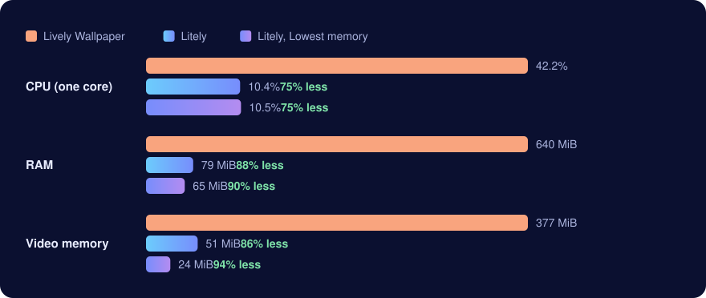

  

<b>Animated video wallpapers for Windows that stay light on your PC.</b>

  
  
  
  

  
  
  
   
  Than Lively Wallpaper, playing the same 1080p 60 fps video on two monitors. <a href="#litely-vs-lively-wallpaper">See the comparison</a>

<!-- Demo video: edit this file on GitHub, drag an MP4 (under 10 MB) onto the next line, and delete the placeholder image. -->

  

Pick a video or GIF and Litely plays it behind your desktop icons, on every monitor. Your GPU does the decoding, playback stops whenever a window or game covers the desktop, and the whole app is one 0.8 MB program.

## Litely vs Lively Wallpaper

The same 1080p 60 fps video as the wallpaper on two monitors, on the same laptop. Shorter bars are better.

  

Litely decodes the video once for all monitors and draws it straight to the desktop. Lively runs a separate player for each monitor.

<b>Exact figures</b>

| | CPU (one core) | RAM | Video memory | Install size |
| --- | --- | --- | --- | --- |
| Lively Wallpaper | 42.2% | 640 MiB | 377 MiB | 396 MB |
| Litely | 10.4% $\color{#3fb950}{\textsf{-75\%}}$ | 79 MiB $\color{#3fb950}{\textsf{-88\%}}$ | 51 MiB $\color{#3fb950}{\textsf{-86\%}}$ | 0.8 MB $\color{#3fb950}{\textsf{-99.8\%}}$ |
| Litely, Lowest memory | 10.5% $\color{#3fb950}{\textsf{-75\%}}$ | 65 MiB $\color{#3fb950}{\textsf{-90\%}}$ | 24 MiB $\color{#3fb950}{\textsf{-94\%}}$ | 0.8 MB $\color{#3fb950}{\textsf{-99.8\%}}$ |

[How this was measured](#performance-in-detail)

## Features

<table>
  <tr>
    <td width="50%" valign="top">
      <h3>Out of your way</h3>
      Stops when a game or window covers the desktop, the PC locks or the screens turn off, and picks up the moment the desktop shows again.
    </td>
    <td width="50%" valign="top">
      <h3>Every monitor, one decoder</h3>
      The video fills each monitor, cropped to fit, and is decoded only once for all of them.
    </td>
  </tr>
  <tr>
    <td valign="top">
      <h3>Lowest memory mode</h3>
      Converts a video once into a form Litely decodes itself, for under 25 MiB of video memory at 1080p.
    </td>
    <td valign="top">
      <h3>Almost any video, or a GIF</h3>
      MP4, MKV, MOV, WebM, AVI, WMV, MPEG and GIF, in any format Windows can decode, including HEVC, VP9 and AV1.
    </td>
  </tr>
  <tr>
    <td valign="top">
      <h3>Pause on any frame</h3>
      The paused frame becomes your Windows wallpaper, so the desktop looks the same while Litely is paused or closed.
    </td>
    <td valign="top">
      <h3>Kind to your battery</h3>
      Optionally plays a 30 fps copy on battery, or pauses while Windows Energy Saver is on.
    </td>
  </tr>
</table>

## Screenshots

  
   The Library, with live CPU, RAM and video memory for the wallpaper

  
   Gallery view

## Install

1. Download **Litely-Setup.exe** from [Releases](../../releases/latest) and run it. It installs for your account only, so there's no administrator prompt.
2. Litely opens its Library. Pick a sample and select **Set wallpaper**, or select **Add video** to use your own.

From then on Litely starts with Windows and sits in the system tray. Prefer no installer? **Litely-portable.zip** runs from any folder.

> [!NOTE]
> Litely isn't code-signed yet, so Windows may say "Windows protected your PC". Select **More info**, then **Run anyway**.

**Requirements:** Windows 10 or 11 (64-bit) and a GPU that decodes H.264 video.

## Good to know

- **Lowest memory** is chosen when you add a video. The converted copy is about three times larger than the original and very slightly softer in fine grain. Your original file is kept.
- **Smooth resume** (default) keeps the player ready so the video restarts instantly. **Maximum savings** frees it whenever the wallpaper is paused or covered. Switch in **Settings** or the tray menu.
- **"Without this window"** under the Library's usage readings estimates what the wallpaper uses once the Library is closed. Litely's RAM figures match Task Manager's Memory column.
- **Only opaque windows count as covering the desktop.** Translucent windows leave the animation running.
- **Your Windows wallpaper** is set to a still from the video on every virtual desktop, so switching desktops is instant. These stills stay out of Windows' Recent images.
- **Your Library, settings and converted copies** are kept in `%LOCALAPPDATA%\Litely`. Uninstalling asks whether to delete them.

## Performance in detail

### Against Lively Wallpaper

<b>How this was measured</b>

- Both apps were measured from outside the same way: CPU time, working-set RAM and the GPU's dedicated memory, summed over all of each app's processes. Medians of three 20-second runs, alternated, November 17, 2026, on an RTX 4060 laptop.
- Lively used its default settings with hardware decoding on, except that its pause rules were set to keep playing while another window had focus.
- Lively runs one mpv player per monitor. On one monitor it measured 25.5% CPU, 469 MiB RAM and 220 MiB video memory.
- No late frames in any Litely run.
- RAM here is the working set, which also counts shared Windows code, so it reads higher than Litely's own figures and Task Manager.

### Against Windows' built-in video player

1080p videos on an RTX 4060 laptop. Lower is better.

| Video | Player | CPU (one core) | RAM | Video memory |
| --- | --- | --- | --- | --- |
| 60 fps | Windows' built-in player | 15.1% | 110 MiB | 59.5 MiB |
| 60 fps | Litely | 10.5% (−30%) | 79 MiB (−29%) | 48.5 MiB (−18%) |
| 60 fps | Litely, Lowest memory | **8.8% (−42%)** | **64 MiB (−42%)** | **21.6 MiB (−64%)** |
| 30 fps | Windows' built-in player | 8.2% | 85 MiB | 59.5 MiB |
| 30 fps | Litely | 5.5% (−33%) | 72 MiB (−16%) | 48.5 MiB (−18%) |
| 30 fps | Litely, Lowest memory | **4.9% (−40%)** | **62 MiB (−27%)** | **21.6 MiB (−64%)** |

On the same laptop's **Intel UHD Graphics**, Lowest memory saves even more:

| Video | Player | RAM | Video memory |
| --- | --- | --- | --- |
| 60 fps | Litely | 158 MiB | 89.8 MiB |
| 60 fps | Litely, Lowest memory | **76 MiB (−52%)** | **29.8 MiB (−67%)** |

At 2160p, Litely used 173 MiB of video memory and Lowest memory 65 MiB.

<b>How this was measured</b>

- Process CPU, working-set RAM and local GPU memory while playing. Medians of three 20-second runs per player, alternated in one session, November 17, 2026. Laptop panel plus one external monitor.
- No late frames in any run, on either GPU. All players show the same picture for the same file.
- Lowest memory plays a converted copy: about three times larger (24.3 MiB and 11.6 MiB for these 10-second videos), colours and edges unchanged, fine grain slightly smoothed (VMAF 96.9 against the source at 60 fps).
- The built-in player's cost varies with the display setup: with only the laptop panel it measured 21.0% and 158 MiB at 60 fps, so the savings there are larger.
- The Intel runs leave out CPU, because Windows copies each frame between the two GPUs outside Litely.
- AMD graphics are untested. If Lowest memory can't run, Litely plays the file the normal way.

## Build from source

Litely is written in C++17 against Win32, Direct3D 11 and Media Foundation.

- **App:** run `build.cmd` with the Visual Studio C++ desktop tools and the Windows SDK. It produces `build\Litely.exe`.
- **Installer and portable zip:** run `installer\build.cmd`, which also needs [Inno Setup 6](https://jrsoftware.org/isinfo.php). Sample wallpapers are bundled from `build\samples` when that folder has MP4s.

See [How Litely works](docs/how-it-works.md) and [Testing](docs/testing.md).

## License

Litely is free software under the [GNU General Public License v3](LICENSE).
