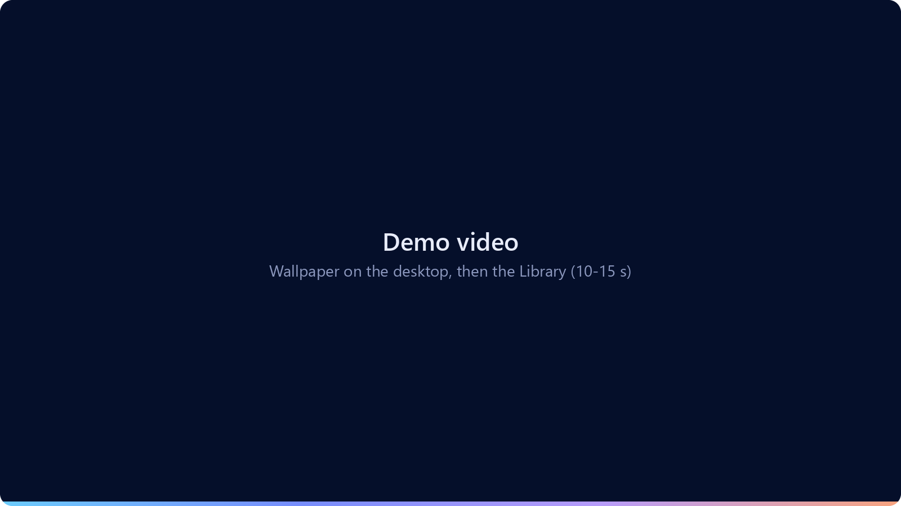

  

<b>Animated video wallpapers for Windows that stay light on your PC.</b>

  
  
  
  

  
  
  
   
  Than Lively Wallpaper, playing the same 1080p 60 fps video on two monitors. <a href="#litely-vs-lively-wallpaper">See the comparison</a>

<!-- Demo video: edit this file on GitHub, drag an MP4 (under 10 MB) onto the next line, and delete the placeholder image. -->

  

## Why Litely

<table>
  <tr>
    <td width="50%" valign="top">
      <h3>Light on resources</h3>
      Under 80 MiB of RAM while playing 1080p at 60 fps, about an eighth of what Lively Wallpaper uses. The GPU decodes the video and draws it straight to the desktop.
    </td>
    <td width="50%" valign="top">
      <h3>Gets out of your way</h3>
      Stops when a game or window covers the desktop, the PC locks or the screens turn off. Starts again the moment the desktop shows.
    </td>
  </tr>
  <tr>
    <td valign="top">
      <h3>One small app</h3>
      A single 0.8 MB program. Nothing else to install: it converts videos itself.
    </td>
    <td valign="top">
      <h3>Lowest memory mode</h3>
      Converts a video once into a form Litely decodes itself, using under 25 MiB of video memory at 1080p.
    </td>
  </tr>
  <tr>
    <td valign="top">
      <h3>Almost any video, or a GIF</h3>
      MP4, MKV, MOV, WebM, AVI, WMV, MPEG and GIF, in any format Windows can decode, including HEVC, VP9 and AV1.
    </td>
    <td valign="top">
      <h3>Every monitor</h3>
      One video fills each monitor, cropped to fit, and is decoded only once for all of them.
    </td>
  </tr>
  <tr>
    <td valign="top">
      <h3>A Library for your wallpapers</h3>
      A list or a gallery, one click to switch, and live CPU, RAM and video memory readings for the wallpaper.
    </td>
    <td valign="top">
      <h3>Pause on any frame</h3>
      Pausing makes the current frame your Windows wallpaper, so the desktop looks the same while Litely is paused or closed.
    </td>
  </tr>
</table>

## Screenshots

  
   Library

  
   Gallery view

## Get started

1. Download **Litely-Setup.exe** from [Releases](../../releases/latest) and run it. It installs for your account only, so there's no administrator prompt.
2. Leave **Start Litely with Windows** ticked so your wallpaper plays after every restart. Tick **Include sample wallpapers** for a few videos to try.
3. Litely opens its Library. Pick a wallpaper and select **Set wallpaper**, or select **Add video** to use your own.

After that, Litely lives in the system tray. Click its icon and choose **Open Litely** to get back to the Library.

Prefer no installer? **Litely-portable.zip** on the same page runs from any folder.

> [!NOTE]
> Litely isn't code-signed yet, so Windows may say "Windows protected your PC". Select **More info**, then **Run anyway**.

**Requirements:** Windows 10 or 11 (64-bit) and a GPU that decodes H.264 video.

## Using Litely

### The Library

- **Set wallpaper** puts the selected video on your desktop. In the gallery, clicking a tile does the same.
- **Pause** freezes the wallpaper on its current frame. **Resume** carries on from there.
- **Remove** takes a wallpaper out of the Library but never deletes the video file. Double-click a wallpaper to rename it. In the gallery, the **⋯** button on a tile does both.
- The arrow on the divider switches between the list and the gallery.
- **Litely usage** shows the live CPU, RAM and video memory, and an estimate of each without the Library window open.

### The tray menu

Click or right-click the Litely icon in the system tray:

| Item | What it does |
| --- | --- |
| **Wallpaper usage** | Live CPU, RAM and video memory used by the wallpaper |
| **Open Litely** | Opens the Library |
| **Choose video...** | Adds a video and puts it on your desktop |
| **Pause on this frame** / **Resume** | Pauses or resumes the wallpaper |
| **Performance** | Switches between Smooth resume and Maximum savings |
| **Settings...** | Opens Settings |
| **Exit Litely** | Closes Litely; your desktop keeps Litely's last still |

### Adding a video

**Add video** opens the Import window with three choices. Litely keeps your original file either way.

| Choice | Options | What it changes |
| --- | --- | --- |
| **Resolution** | Original, 1080p, 720p | A smaller copy uses less memory |
| **Frame rate** | Original, 30 fps | A 30 fps copy uses less CPU |
| **Playback** | Standard, **Lowest memory** (default) | Lowest memory converts the video once into a form Litely decodes itself, using about half the video memory |

The window shows an estimate of the saving before you convert, and progress while it converts. Conversion uses your GPU's video encoder when it has one.

A Lowest memory copy is about three times larger than the original and very slightly softer in fine grain. GIFs and MPEG streams (`.mpg`, `.ts`) always get a copy. If Windows has no decoder for a video, Litely names the Microsoft Store extension to install (HEVC, AV1, VP9 or MPEG-2).

## Settings

Open **Settings** from the Library or the tray menu.

| Section | Setting | What it does | Default |
| --- | --- | --- | --- |
| Performance | **Smooth resume** | Keeps the player ready, so the video restarts instantly | On |
| Performance | **Maximum savings** | Frees the player after a pause or two seconds of full coverage, so it uses the least memory | Off |
| Battery | **Pause when Energy Saver is on** | Pauses the wallpaper on battery while Windows Energy Saver is on | Off |
| Battery | **30 fps on battery** | Makes a 30 fps copy of the wallpaper once, in the background, and plays it on battery | Off |
| Appearance | **Match wallpaper** / **Choose a colour** | Sets the accent colour from your wallpaper or from eight colours | Match wallpaper |
| Startup | **Start with Windows** | Opens Litely quietly in the tray when you sign in | Set by the installer |

## Good to know

- **Your desktop never goes blank.** Choosing a video also sets a still from it as the Windows wallpaper, on every virtual desktop. Windows shows it while the player starts and after you exit.
- **Your Recent images stay tidy.** Litely keeps its stills out of **Settings > Personalization > Background > Recent images**.
- **Covered means opaque.** Translucent and irregular windows can leave the animation running, because only opaque windows count as covering the desktop.
- **Litely's RAM figures match Task Manager.** The Library and tray show the same number as Task Manager's Memory column. The tables below use the working set, which is higher because it also counts shared Windows code.
- **Where your data lives.** Your Library, settings and converted copies are in `%LOCALAPPDATA%\Litely`. Uninstalling asks whether to delete them.

## Litely vs Lively Wallpaper

The same 1080p 60 fps video on the same laptop, as the wallpaper on both monitors. Lower is better.

| App | CPU (one core) | RAM | Video memory | Install size |
| --- | --- | --- | --- | --- |
| Lively Wallpaper | 42.2% | 640 MiB | 377 MiB | 396 MB |
| Litely | 10.4% (−75%) | 79 MiB (−88%) | 51 MiB (−87%) | 0.8 MB |
| Litely, Lowest memory | **10.5% (−75%)** | **65 MiB (−90%)** | **24 MiB (−94%)** | **0.8 MB** |

<b>How this was measured</b>

- Both apps were measured from outside the same way: CPU time, working-set RAM and the GPU's dedicated memory, summed over all of each app's processes. Medians of three 20-second runs, alternated, November 17, 2026, on an RTX 4060 laptop.
- Lively used its default settings with hardware decoding on, except that its pause rules were set to keep playing while another window had focus.
- Lively runs one mpv player per monitor. On one monitor it measured 25.5% CPU, 469 MiB RAM and 220 MiB video memory.
- Litely decodes once for all monitors. No late frames in any Litely run.

## Performance

Litely against Windows' built-in video player on 1080p videos, RTX 4060 laptop. Lower is better.

| Video | Player | CPU (one core) | RAM | Video memory |
| --- | --- | --- | --- | --- |
| 60 fps | Windows' built-in player | 15.1% | 110 MiB | 59.5 MiB |
| 60 fps | Litely | 10.5% (−30%) | 79 MiB (−29%) | 48.5 MiB (−18%) |
| 60 fps | Litely, Lowest memory | **8.8% (−42%)** | **64 MiB (−42%)** | **21.6 MiB (−64%)** |
| 30 fps | Windows' built-in player | 8.2% | 85 MiB | 59.5 MiB |
| 30 fps | Litely | 5.5% (−33%) | 72 MiB (−16%) | 48.5 MiB (−18%) |
| 30 fps | Litely, Lowest memory | **4.9% (−40%)** | **62 MiB (−27%)** | **21.6 MiB (−64%)** |

On the same laptop's **Intel UHD Graphics**, Lowest memory saves even more:

| Video | Player | RAM | Video memory |
| --- | --- | --- | --- |
| 60 fps | Litely | 158 MiB | 89.8 MiB |
| 60 fps | Litely, Lowest memory | **76 MiB (−52%)** | **29.8 MiB (−67%)** |

At 2160p, Litely used 173 MiB of video memory and Lowest memory 65 MiB.

<b>How this was measured</b>

- Process CPU, working-set RAM and local GPU memory while playing. Medians of three 20-second runs per player, alternated in one session, November 17, 2026. Laptop panel plus one external monitor.
- No late frames in any run, on either GPU. All players show the same picture for the same file.
- Litely plays the original file untouched. Lowest memory plays a converted copy: about three times larger (24.3 MiB and 11.6 MiB for these 10-second videos), colours and edges unchanged, fine grain slightly smoothed (VMAF 96.9 against the source at 60 fps).
- The built-in player's cost varies with the display setup: with only the laptop panel it measured 21.0% and 158 MiB at 60 fps, so the savings there are larger.
- The Intel runs leave out CPU because both displays are wired to the NVIDIA GPU, so Windows copies each frame across outside Litely.
- AMD graphics are untested. If Lowest memory cannot run, Litely plays the file the normal way.

## Build from source

Litely is written in C++17 against Win32, Direct3D 11 and Media Foundation.

- **App:** run `build.cmd` with the Visual Studio C++ desktop tools and the Windows SDK installed. It produces `build\Litely.exe`.
- **Installer and portable zip:** run `installer\build.cmd`, which also needs [Inno Setup 6](https://jrsoftware.org/isinfo.php). It produces `Litely-Setup.exe` and `Litely-portable.zip` in `build\installer`. Sample wallpapers are bundled from `build\samples` when that folder has MP4s.

See [How Litely works](docs/how-it-works.md) and [Testing](docs/testing.md).

## License

Litely is free software under the [GNU General Public License v3](LICENSE).
